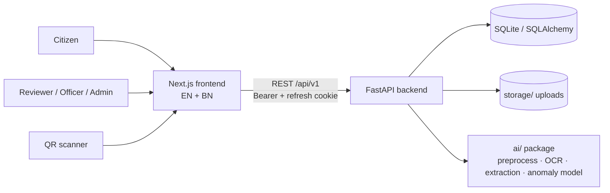
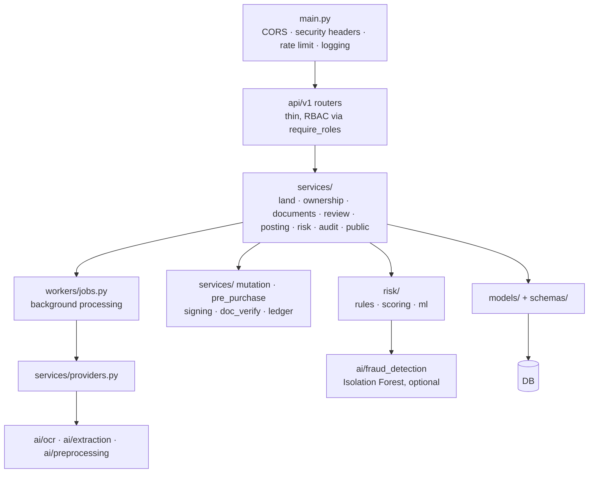
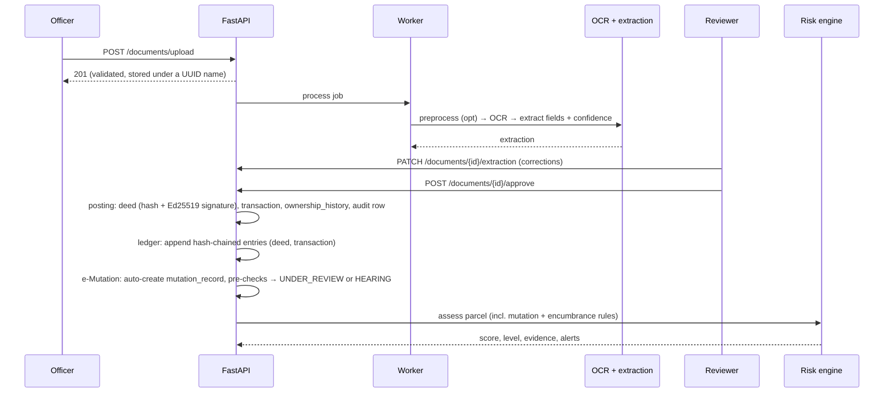
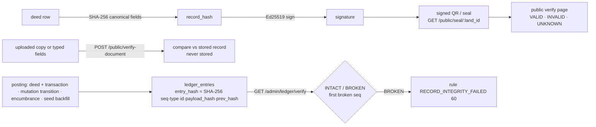
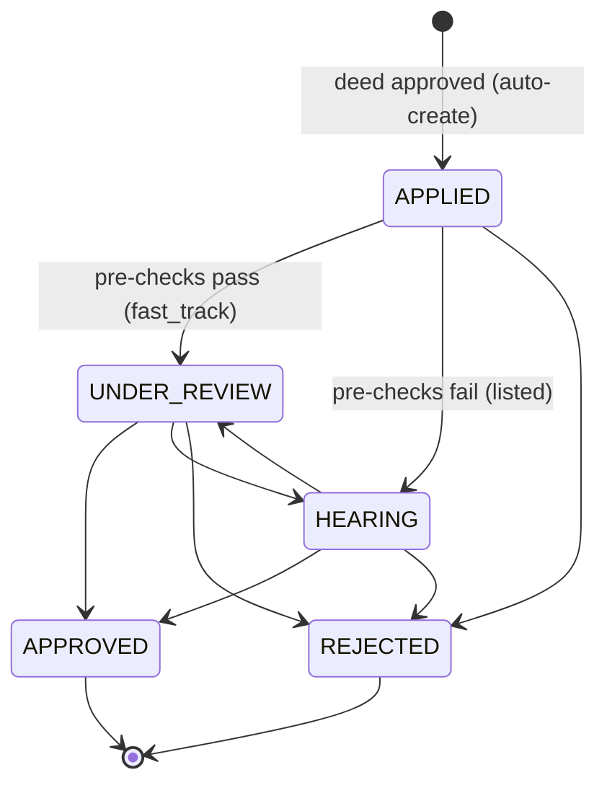
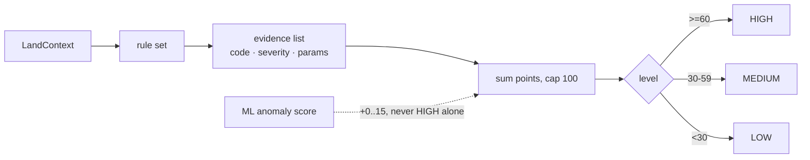

# Architecture

Demo dataset only. Not an official government system.

## System context

## Backend layers

Rules are pure functions over a `LandContext` dataclass (no DB access inside rules).

## Document to risk flow

## Trust layer (F4)

The chain is only as strong as DB write access; `scripts/tamper_demo.py` breaks and restores it for the demo.

## e-Mutation state machine (F2)

Manual transitions are OFFICER/ADMIN only; HEARING and REJECTED need a reason; each transition is audited and appended to the ledger. Pending mutations (APPLIED, UNDER_REVIEW, HEARING) and registered-but-unmutated transactions feed the risk rules and the "Check Before You Buy" checklist.

## Risk scoring

Rule weights live in `backend/app/risk/config.py` (single source of truth). INFO and 0-point evidence never creates an alert.

## Data model

```mermaid
erDiagram
  USERS ||--o{ DOCUMENTS : uploads
  USERS ||--o{ VERIFICATION_REQUESTS : requests
  USERS ||--o{ AUDIT_LOGS : acts
  LAND_PARCELS ||--o{ DEEDS : has
  LAND_PARCELS ||--o{ TRANSACTIONS : has
  LAND_PARCELS ||--o{ OWNERSHIP_HISTORY : has
  LAND_PARCELS ||--o{ RISK_ASSESSMENTS : scored
  LAND_PARCELS ||--o{ FRAUD_ALERTS : raises
  LAND_PARCELS ||--o{ VERIFICATION_REQUESTS : verified
  OWNERS ||--o{ OWNERSHIP_HISTORY : holds
  OWNERS ||--o{ TRANSACTIONS : "seller / buyer"
  LAND_PARCELS ||--o{ DOCUMENTS : "linked after approval"
  DOCUMENTS ||--o{ DEEDS : "source of"
  DOCUMENTS ||--o{ TRANSACTIONS : "source of"
  DEEDS ||--o{ TRANSACTIONS : "backs"
  TRANSACTIONS ||--o{ FRAUD_ALERTS : "may raise"
  LAND_PARCELS ||--o{ MUTATION_RECORDS : "khatian updates"
  DEEDS |o--o{ MUTATION_RECORDS : "registered by"
  TRANSACTIONS |o--o{ MUTATION_RECORDS : "mutates"
  OWNERS ||--o{ MUTATION_RECORDS : "applicant / new holder"
  LAND_PARCELS ||--o{ LAND_ENCUMBRANCES : "case · khas · acquisition · mortgage"
  LEDGER_ENTRIES ||--o| LEDGER_ENTRIES : "prev_hash"
```

`ledger_entries` has no FK: each row stores `entity_type` + `entity_id` + `payload_hash` so it survives edits to the source row and can detect them. Migrations: 0004 mutation_records · 0005 land_encumbrances · 0006 deed record_hash/signature · 0007 ledger_entries.

Column-level detail: `backend/app/models/` and the Alembic revisions.

## Frontend

App Router under `frontend/app/[locale]/` (`/en`, `/bn`). Pages: landing, login, verify (incl. pre-purchase check and verify-a-copy), verify/result (tabs: ownership · transactions · mutation · cases/encumbrance · evidence), verify/graph, report/[id], v/[landId] (public QR page), map, officer (dashboard, upload, review, mutation queue + detail, audit-logs), admin (users, land records, documents, ledger integrity), about. Feature code in `frontend/features/*`, shared UI in `frontend/components`, strings in `frontend/messages/{en,bn}.json` (parity checked by `npm run check:i18n`). The access token is held in memory; the refresh cookie is HttpOnly.

## Roles

CITIZEN, REVIEWER, OFFICER, ADMIN. Enforced per route by `require_roles`; the whole matrix is tested (`backend/tests/security/test_authz_matrix.py`). The role is read from the database, never from the token.
