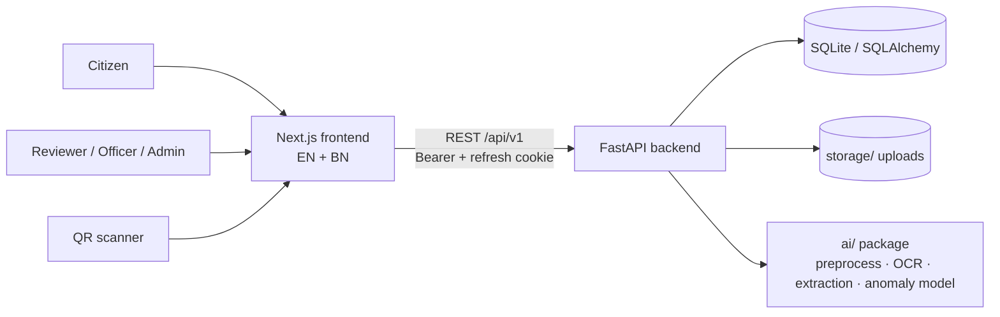
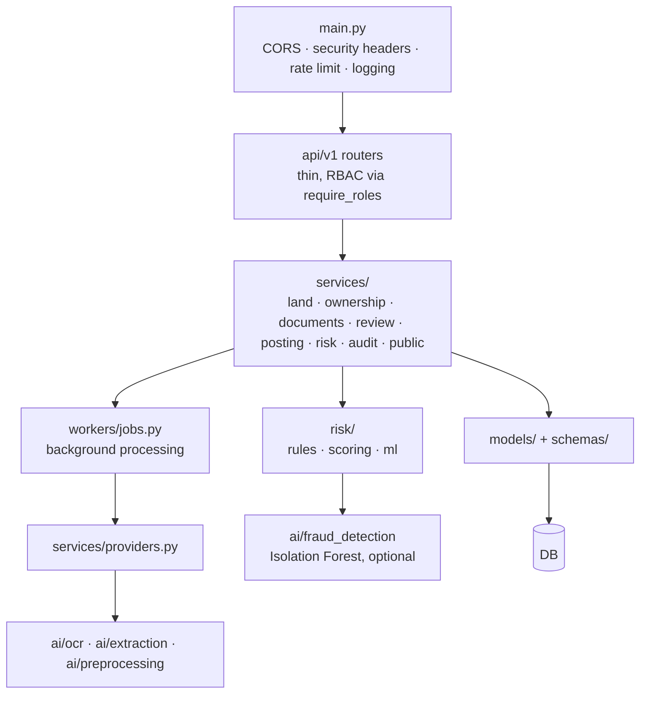
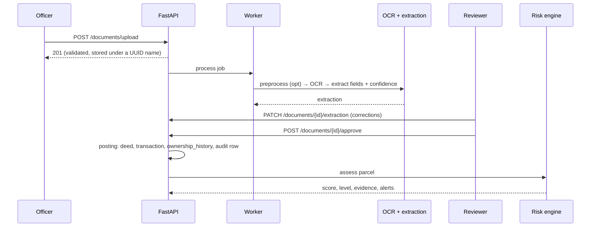
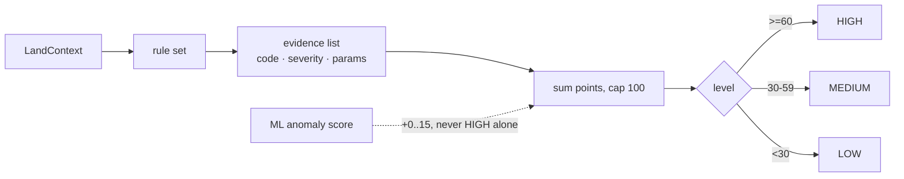
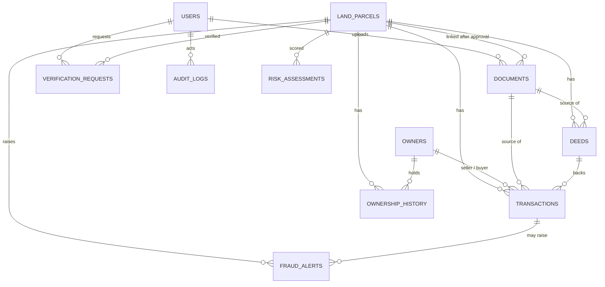

# Architecture

Demo dataset only. Not an official government system.

## System context

## Backend layers

Rules are pure functions over a `LandContext` dataclass (no DB access inside rules).

## Document to risk flow

## Risk scoring

Rule weights live in `backend/app/risk/config.py` (single source of truth). INFO and 0-point evidence never creates an alert.

## Data model

Column-level detail: `backend/app/models/` and the Alembic revisions.

## Frontend

App Router under `frontend/app/[locale]/` (`/en`, `/bn`). Pages: landing, login, verify, verify/result, verify/graph, report/[id], v/[landId] (public QR page), map, officer (dashboard, upload, review, audit-logs), about. Feature code in `frontend/features/*`, shared UI in `frontend/components`, strings in `frontend/messages/{en,bn}.json` (parity checked by `npm run check:i18n`). The access token is held in memory; the refresh cookie is HttpOnly.

## Roles

CITIZEN, REVIEWER, OFFICER, ADMIN. Enforced per route by `require_roles`; the whole matrix is tested (`backend/tests/security/test_authz_matrix.py`). The role is read from the database, never from the token.
