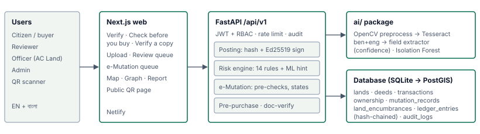
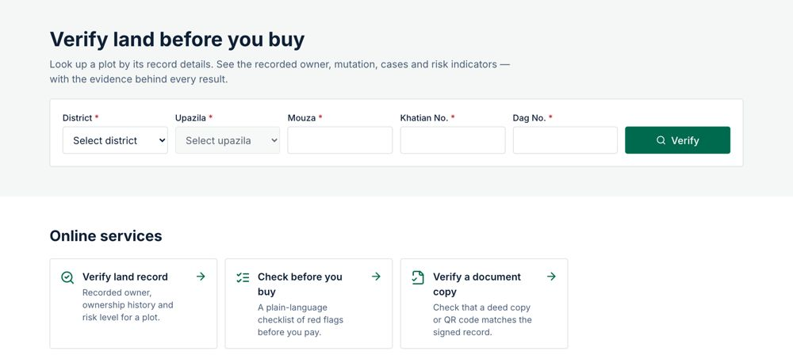
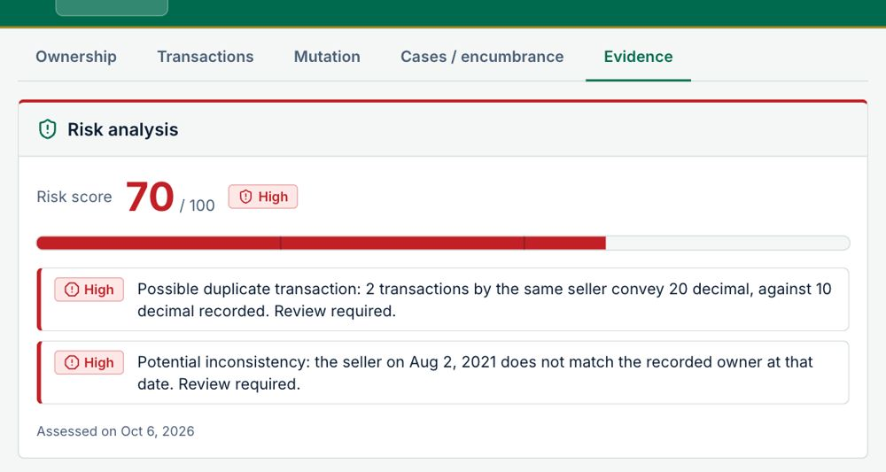
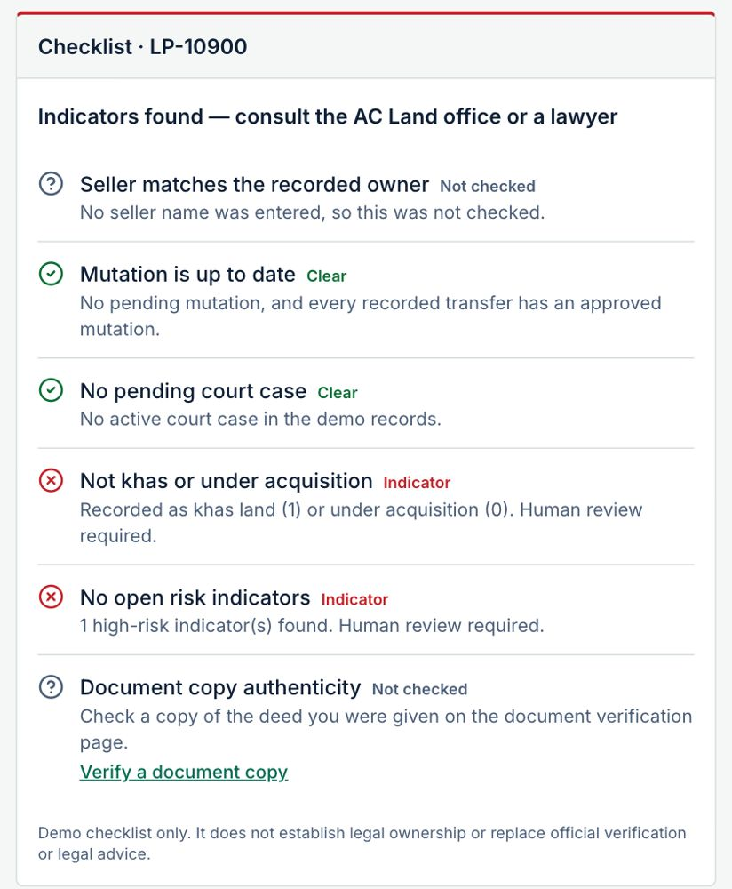
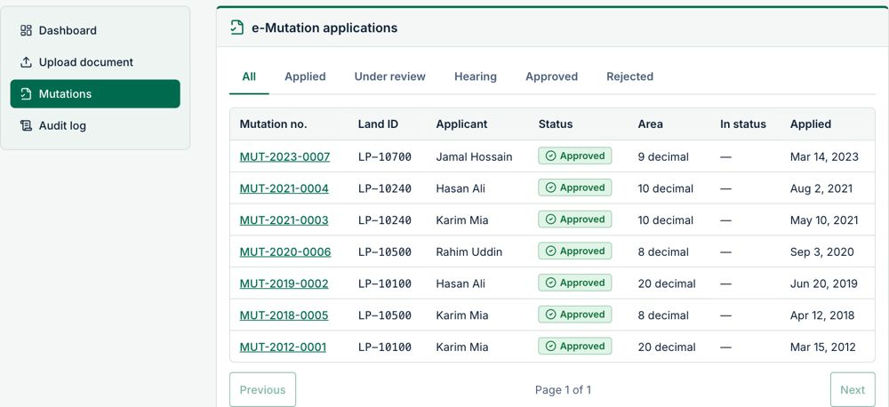
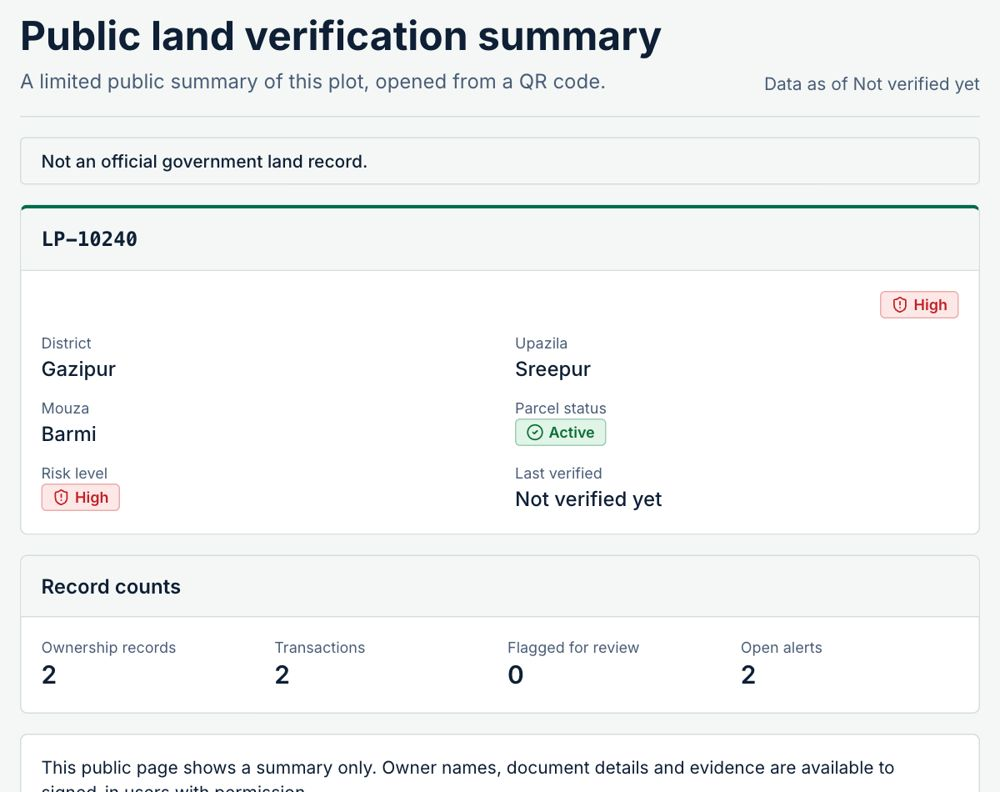
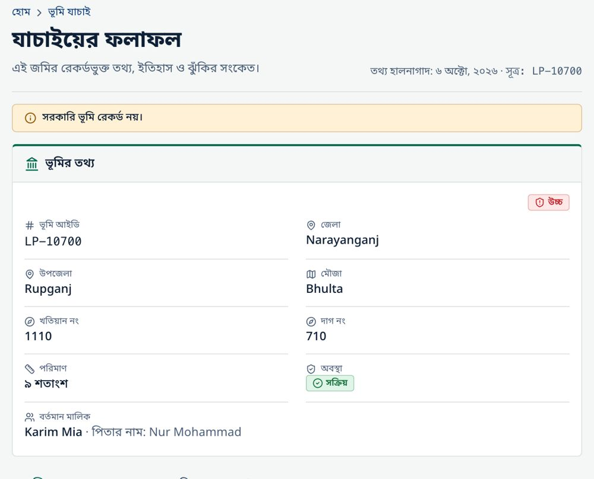

# LandShield BD — Concept Note

**LandTech 2026 · Track: Digital Land Records, Verification & Digitization · Problem statement P3: Fraud & Double-Selling** (supporting: P1, P2, P4, P5) 
Team: DEEDGUARD · Live demo: https://land-sheild-bd.netlify.app/en · Code: https://github.com/A-42-018/LandSheild-BD · Video: VIDEO_URL

> Demo prototype. All land, deed and person records are synthetic. LandShield gives risk *indicators* for a human to review; it does not establish ownership or replace official verification.

## 1. Problem (P3)

A plot in Bangladesh can be sold twice, sold by someone who is no longer the recorded owner, or "proved" with a copied or altered deed. These frauds work because the evidence is split: the sale deed is registered at the **Sub-Registry office** (Ministry of Law), while the ownership record (khatian) is updated through **mutation (namjari)** at the **AC Land office** (Ministry of Land). Nobody checks both sides automatically, so a buyer often learns of a second sale, a pending case or khas status only in court. LandShield targets the four P3 scenarios: **same plot sold twice, rapid transfers, registration ↔ mutation mismatch, and forged or altered documents**. It also covers parts of P1 (digitising deeds with OCR), P2 (signed records, hash-chained ledger, QR), P4 (deed → e-Mutation workflow) and P5 (a "check before you buy" for citizens).

## 2. Bangladesh context

- **Land dominates litigation.** The Senior Secretary of the Ministry of Land has said almost **80 % of all court cases** are land disputes [1]. In a nationwide HiiL/BRAC justice-needs survey, land was the most common serious legal problem (**29 %** of problems) [2].
- **Land services are trust-poor.** TIB's National Household Survey (May 2023 – Apr 2024) found that **51 %** of households using land services faced corruption and **32.3 %** paid bribes [3].
- **Records live in layers.** Plots carry CS, SA, RS and BS (city) survey khatians from different eras. These records are held in different offices and often disagree on owner, area or dag number. Mutation that lags behind registration leaves a buyer's name off the khatian. That gap lets the old owner sell again.

## 3. Solution: one pipeline from deed to citizen

**Scan → Verify → Detect → Mutate → Citizen check**

1. **Scan.** An officer uploads a deed image. OCR (Tesseract `ben+eng`, or a mock provider for offline demos) and a rules extractor fill 12 fields (deed no., date, district/upazila/mouza, khatian, dag, area, seller, buyer…), each with a confidence score.
2. **Verify.** A reviewer corrects any low-confidence field and approves. Nothing reaches the record without human approval. On approval, the deed is hashed (SHA-256), **signed (Ed25519)** and appended to a **hash-chained ledger**.
3. **Detect.** An explainable rule engine scores each parcel 0–100 (LOW / MEDIUM / HIGH). It has 14 scored rules, including possible duplicate transaction (double sale), seller ≠ recorded owner, duplicate deed number, area mismatch, registered-but-not-mutated, mutation to a different party, active court case, khas land, land under acquisition, and record-integrity failure. Every indicator shows its evidence. An Isolation-Forest anomaly hint can add at most 15 points and can **never create HIGH on its own**.
4. **Mutate.** Approving a deed opens an **e-Mutation application** by itself. Six pre-checks (seller is the recorded owner, no open HIGH alert, no active case, not khas or acquired, area within the seller's holding, document human-approved) send it to *fast track* or *hearing*. Officers work through a queue with a state machine, and a rejection must give a reason.
5. **Citizen check.** Before paying, a buyer enters the plot (and optionally the seller's name) and gets a six-point plain-language checklist in English or Bangla. They can also upload a copy of a deed to find out which fields were altered, or scan the QR code on a report. The QR page shows a signed public summary with no personal data.

## 4. Architecture and tech stack

| Layer | Stack |
|---|---|
| Frontend | Next.js 14 (App Router), TypeScript, Tailwind, next-intl (EN + BN), TanStack Query, Leaflet map, React Flow ownership graph |
| Backend | Python 3.11, FastAPI, SQLAlchemy 2 + Alembic (SQLite demo; Postgres/PostGIS planned), Pydantic 2, JWT + role-based access (citizen / reviewer / officer / admin), rate limits, audit log |
| AI / trust | Tesseract + OpenCV preprocessing, rule extractor, rapidfuzz name matching (Bangla-aware), scikit-learn Isolation Forest; SHA-256, Ed25519 signatures, hash-chained ledger |
| Quality / deploy | pytest, Vitest (350 tests), Playwright e2e (20 specs), ruff, tsc; Docker → Render (API), Netlify (web) |

## 5. Key features

Other features: ownership graph (one seller → two buyers), parcel map of Bangladesh (simplified open boundaries, not official; synthetic plots), a bilingual A4 report, verify-a-copy (Doc1 vs Doc1_altered → **ALTERED: land_area**), and a ledger tamper demo (edit a row → **BROKEN at seq 7** → restore → **INTACT**).

## 6. AI metrics and limitations

| Measure (synthetic data) | Result |
|---|---|
| Rule engine, seeded fraud scenarios | precision **1.00**, recall **1.00** (3/3 codes, 0 false positives) |
| Anomaly model, held-out split (2 000 rows) | precision 0.974 · recall 0.935 · F1 0.954 · ROC AUC 0.998 |
| OCR + extraction, 20 synthetic deeds (exact / fuzzy) | 30.0 % / 47.9 % of fields overall; 61.9 % / 94.0 % on clean English-label deeds |

**Limitations (stated honestly).** Every number comes from synthetic data. Bangla OCR accuracy has **not** been measured yet, and noisy scans currently fail extraction, which is why human review is mandatory. The anomaly score is not a probability. The ledger is only as strong as write access to the database (anchoring the chain head off-database comes next). The demo uses SQLite with no real registry integration. The free hosting tier sleeps, so the first request has a cold start.

## 7. Countrywide implementation plan

| Stage | Scope | Integration |
|---|---|---|
| Pilot (6 months) | 1 upazila: 1 Sub-Registry + 1 AC Land office | Read-only registration and mutation feeds; digitise the pilot mouza's khatians |
| District (12 months) | 1 district | Live e-Mutation API, court cause-list feed, DC office khas register |
| National (24–36 months) | 64 districts | Permissioned ledger nodes at Sub-Registry / AC Land / DC offices; national search; mobile + SMS "check before you buy"; bank API for collateral checks |

Cross-cutting work: Postgres/PostGIS and horizontal scaling; Bangla OCR fine-tuned on anonymised archives (with legal approval); data protection by design (no personal data on public pages, hashed identifiers, audit trail); officer training. Expected impact: fewer double sales reaching court, faster mutation, and fewer broker visits for buyers.

## 8. Team, mentors and AI disclosure

| Name | Role |
|---|---|
| Alif Mahmud | Backend, risk engine, e-Mutation, ledger |
| Ayesha Hamid Mithila | Frontend, OCR pipeline, UI, deployment |
| — | Mentor: not assigned yet |

**AI tool disclosure.** Claude (Anthropic) helped write code, tests and documentation, phase by phase. The team reviewed, ran and edited everything. No generative AI runs at runtime, and all risk decisions come from deterministic, explainable rules.

**Sources.** [1] *Daily Observer*, "Land case backlog weighs on our legal system", 8 Nov 2025 (observerbd.com/news/552680). [2] HiiL & BRAC, *Justice Needs and Satisfaction in Bangladesh*, 2018 (brac.net). [3] TIB, *Corruption in Service Sectors: National Household Survey 2023*, 3 Dec 2024 (ti-bangladesh.org/en/articles/press-release/7136).
